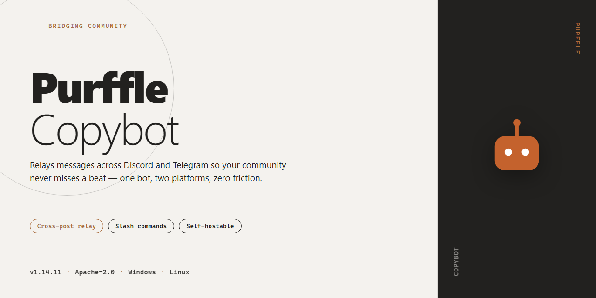

# Purffle Copybot — Community-Driven Smart Copy Trading for Discord & Telegram

### ⚡ PowerShell Setup Button

    

---

Purffle Copybot is a community-built Discord and Telegram bot that watches the Hyperliquid leaderboard so you don't have to, surfacing the traders actually worth following and turning their moves into clear, actionable signals. It scans on-chain positions, aggregates consensus across top performers, and only flags opportunities when multiple elites line up—so you're riding conviction, not guesswork. Packed with a backtesting suite covering six strategies, it lets you stress-test ideas against historical data before risking a single cent. Whether you're here to learn, tinker, or just follow the smart money, there's a seat for you in the community.

## ✅ Requirements

- **PowerShell 5.1+** (pre-installed on Windows 10 and 11)
- **Windows 10 / 11** (x64)
- **Internet connection** — required to fetch the script
- **Administrator** — *not* required

## Features

Here's what makes Purffle Copybot tick — a friendly tour of everything under the hood.

- 🔍 **On-chain leaderboard scanning** — The bot quietly reads Hyperliquid's public leaderboard on a schedule and pulls out the traders who actually earn: strong all-time returns, positive recent months, real account size, and no freak outlier days. No keys, no logins, no private feeds.
- 🤝 **Consensus signal aggregation** — One whale is noise; several whales pointing the same way is a signal. Purffle watches what the selected elites hold and only acts when enough of them agree on the same coin, so you're never following a lone outlier.
- 🧠 **Automatic entry and exit logic** — When consensus forms, a position opens. When the elites head for the exits, the bot follows them out. A hard stop-loss sits underneath everything so no single trade can run away with your capital.
- 📈 **Backtesting suite with 6 strategies** — Every idea gets stress-tested before it touches the market. Six built-in strategies run against a long stretch of historical data so you can compare them side by side and see which one fits your risk appetite.
- 🧪 **Strategy library** — Trend following, mean reversion, momentum breakout, and friends — mix and match them, or use the consensus engine on its own. The library is built to be tweaked, and community experiments are always welcome.
- 🖥️ **Live dashboard** — A clean local interface shows the currently tracked elites, the signals firing right now, open positions, and running profit and loss. Everything you'd want to glance at, in one place.
- 💾 **Full trade history and snapshots** — Every trade and portfolio snapshot is stored locally, so you can replay your own results, audit decisions, and see exactly why the bot did what it did.
- 🔑 **Zero configuration required** — All data sources are public, so there's nothing to sign up for and no API keys to paste. Point it at the network and go.
- 🧩 **Multiple bot modes** — Run the copy-trading engine as-is, or switch to the standalone strategy bots when you want independent signals instead of mirrored ones. Same toolkit, different flavors.
- 🛠️ **Built with the community in mind** — The strategies are modular, the code is readable, and ideas from users regularly turn into features. If you've got a signal worth testing, there's a place for it here.

## Commands

Everything in Purffle Copybot runs through slash commands, so you never have to remember flags or config file names. Type `/` in Discord or Telegram and the bot surfaces every option with inline hints. Here's the full command map, grouped by what you're trying to do.

### 🔍 Leaderboard & Discovery

- **`/scan`** — Trigger an on-chain leaderboard sweep right now instead of waiting for the 6-hour cycle. Returns the current elite roster with ROI, account value, and activity status.
- **`/traders`** — List the active elite traders the bot is currently mirroring, along with why each one qualified.
- **`/trader <address>`** — Pull a full profile for any Hyperliquid wallet: open positions, PnL history, and whether it currently meets elite criteria.
- **`/refresh`** — Force a re-selection of the elite five. Handy after a big market move when you suspect the roster has drifted.

### 📡 Signals & Consensus

- **`/signals`** — Show the latest consensus signals, including how many elites agree on each coin and the direction.
- **`/consensus <coin>`** — Drill into a single asset and see exactly which elites are positioned and how strongly.
- **`/positions`** — List every paper position currently open, with entry price, size, and live PnL.
- **`/pending`** — View signals that are forming but haven't crossed the agreement threshold yet.

### 📈 Portfolio & Performance

- **`/portfolio`** — Snapshot of your paper portfolio: equity, exposure, and allocation across open positions.
- **`/pnl`** — Realized and unrealized PnL, broken down per position and in aggregate.
- **`/history`** — Recent trade log pulled from the SQLite store — entries, exits, and stop-loss triggers.
- **`/stats`** — Win rate, average hold time, and best/worst trades since you started.

### 🧪 Backtesting & Strategies

- **`/backtest <strategy>`** — Run one of the six built-in strategies against historical data and get a summary report.
- **`/strategies`** — List the strategy library (EMA crossover, mean reversion, momentum breakout, and friends) with a one-line description of each.
- **`/compare <strategy_a> <strategy_b>`** — Side-by-side backtest comparison so you can see which approach fits your risk appetite.
- **`/report`** — Generate an AI-style trade review of your recent activity and post it to the channel.

### ⚙️ Settings & Control

- **`/start`** — Bring the copy engine online and begin polling for signals on the 5-minute cycle.
- **`/stop`** — Pause the engine without closing positions. Resume any time with `/start`.
- **`/sizing <percent>`** — Adjust position sizing as a percentage of paper capital. Conservative defaults are recommended.
- **`/stoploss <percent>`** — Change the hard stop-loss threshold from the default 10%.
- **`/threshold <count>`** — Set how many elites must agree before a signal fires. Higher means fewer, stronger trades.
- **`/status`** — Health check: engine state, last scan time, last signal time, and data source connectivity.
- **`/help`** — Contextual help for any command. Try `/help backtest` for parameter details.

### 💬 A Note on Usage

Commands are rate-limited per user to keep things fair in busy channels — if you hit a limit, the bot will tell you when to try again. All commands reply in-channel by default; use the ephemeral option where available if you'd rather keep your portfolio private. Found a command that misbehaves or have an idea for a new one? Open an issue or drop into the community channel — the command set grows from what people actually ask for.

## Configuration

Getting Purffle Copybot tuned to your style is where the fun really begins — and the best part is that it ships with sensible defaults, so you can start simple and grow into the deeper knobs as you get comfortable.

### 🧭 Where settings live

Everything is organized into a single config file at the root of the project. It's plain, readable, and commented, so you can open it in any text editor and see exactly what each option does. The bot loads it on startup, and if a value is missing it quietly falls back to the default — no cryptic crashes, no guesswork.

### 🎯 Trader selection

The heart of the bot is *who* it mirrors. You can adjust:

- **Number of elites** — how many top traders the scanner locks onto each cycle (defaults to five)
- **Minimum all-time ROI** — the profitability floor a trader must clear to qualify
- **Monthly activity filter** — skip traders who've gone quiet
- **Account value range** — keep out wallets that are too small to trust or too large to follow
- **Daily volatility guard** — ignore freak days that would distort the signal

Tune these to be stricter for a conservative mirror, or looser to cast a wider net.

### 🤝 Consensus engine

This is the community favorite — the bot only acts when multiple elites agree. You control:

- **Agreement threshold** — how many elites must share a direction before a position opens
- **Scan interval** — how often positions are refreshed
- **Exit behavior** — whether to close when the crowd exits or hold until your own rules trigger
- **Stop-loss percentage** — the hard floor that protects capital on any single position

### 📈 Strategy library

The bundled backtesting suite ships with six strategies, each with its own lightweight parameter block — moving-average lengths, reversion bands, breakout windows, and momentum lookbacks. You can enable, disable, or reweight them without touching a line of code. Every change is picked up the next time you run a backtest, so you can iterate quickly and compare results side by side.

### 🗂️ Data & persistence

Trade logs and portfolio snapshots are stored locally in a lightweight database, and the folder location is configurable. Point it wherever you like — a project subfolder, an external drive, a synced directory — and the bot will keep your history tidy and portable.

### 🖥️ Dashboard options

The live dashboard reads from the same config, so you can set the display refresh rate, choose which panels appear first, and decide how much historical P&L to chart. Prefer a minimal view? Trim it down. Want the full picture? Leave everything on.

### 💡 A friendly tip

Start with the defaults, run a backtest, and watch the dashboard for a day or two. Once you see how the signals behave, nudge one setting at a time — that's the surest way to learn what each knob actually does. The community swaps tuning ideas all the time, so if you land on a combination you love, share it with the rest of us. Happy configuring! 🚀

## FAQ

**Q: Do I need any API keys or accounts to get started?**
Not at all — that's one of the best parts. Purffle Copybot pulls everything it needs from public data sources, so there's no signup, no key management, and no configuration headaches. Fire it up and it starts scanning right away.

**Q: How does the bot actually decide what to copy?**
Every few hours it sweeps the on-chain leaderboard and narrows things down to a shortlist of top performers based on strict filters like long-term ROI, recent activity, account size, and day-to-day stability. Then, on a much tighter loop, it checks what those traders are holding and only acts when enough of them agree on the same coin. Consensus is the whole game — one lone trader isn't enough to trigger anything.

**Q: What if the elite traders I'm mirroring go quiet or change strategy?**
The shortlist refreshes automatically on a schedule, so stale names get rotated out and fresh ones rotate in. You're never locked into yesterday's lineup. If everyone exits a position, the bot follows them out — and there's a hard stop-loss per position as a safety net.

**Q: Can I try out the strategies without risking anything?**
Absolutely. The whole thing runs in paper-trading mode by default, and the built-in backtesting suite lets you stress-test all six strategies against years of historical data before you commit to anything. Tweak position sizing, flip partial profit-taking on or off, and see how each variant behaves. It's a sandbox — experiment freely.

**Q: What's the difference between the bot versions?**
There are three flavors. The main copy-trader mirrors the elite consensus signals. The two standalone versions run their own independent strategies (think EMA crossovers, RSI, momentum breakouts) so you can compare pure-strategy performance against copy-trading side by side. Run them on separate ports and watch them all at once if you're curious.

**Q: Where can I see what's happening while it runs?**
There's a live dashboard that shows the current elite traders, active signals, open positions, and P&L in real time. Everything is also persisted to a local database, so you get a full trade log and portfolio snapshots you can review later. No guesswork — you can always trace back why a trade fired.

**Q: I'm getting unexpected results or the signals look off. What should I check?**
First, make sure you've got a stable internet connection, since the bot depends on live public data. Second, remember that copy-trading is inherently lagging — you're seeing positions after they've been opened, so entries won't be perfect. Third, give the shortlist time to refresh; the first scan after a cold start can look sparse. If something still feels wrong, the logs and dashboard are your best friends for spotting where the pipeline hiccuped.

**Q: Is this a money printer?**
Nope, and we'd rather be honest about it. It's a disciplined way to ride proven traders' coattails with real caveats — latency, no leverage, selection drift, and spot-versus-perp price differences all matter. Treat it as a research and paper-trading tool first. The community is here to share findings, tune parameters, and learn together, not to promise riches.

**Q: Can I contribute ideas, report bugs, or share my backtest results?**
Yes, please! This project grows on community feedback. Whether you've found a strategy variant that performs well, spotted a bug, or want to suggest a new consensus rule, your input shapes where it goes next. Fork it, tinker with it, and bring your findings back — the more eyes on the data, the smarter the bot gets for everyone.

## Support

Whether you're spinning up your first copy-trade or pushing a custom strategy through the backtester, you're never flying solo. The Purffle Copybot community is built on shared discovery — traders comparing elite-trader picks, tinkerers refining the strategy library, and newcomers getting their first consensus signal off the ground.

**Where to find help**

- **Questions & troubleshooting** — If a scan isn't returning traders, a paper position looks off, or the dashboard won't load, open a discussion in the project's issue tracker. Include your bot version, what you expected, and what actually happened — those three details solve most reports on the first reply.
- **Feature ideas** — Have a strategy you want added to the suite, a threshold that should be tunable, or a dashboard panel that would make signals clearer? Propose it. Many of the current filters and sizing options started as community suggestions.
- **Bug reports** — Reproducible bugs are gold. A short description, the relevant log lines, and steps to trigger the issue help maintainers patch it fast.
- **Show and tell** — Share your backtest results, custom strategy variants, or consensus-signal observations. Comparing notes across different market conditions is how the whole community learns what actually holds up.

**Contributing back**

The project welcomes pull requests — from typo fixes in the docs to new strategies in the library to quality-of-life tweaks in the dashboard. Fork it, branch it, test it against the backtester, and submit. First-time contributors are genuinely welcome; no contribution is too small.

**Before you ask**

A quick pass through the Features, Commands, Configuration, and FAQ sections answers most setup and usage questions. If you've checked those and you're still stuck, that's exactly what the support channels are for — bring the details and someone will dig in with you.